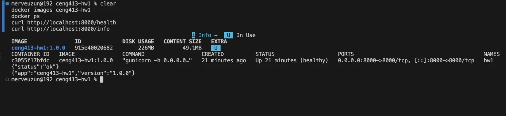

# CENG413 HW-1: Containerized Flask App

Build: `docker build -t ceng413-hw1:1.0.0 .`

Run: `docker run -d --name hw1 -p 8000:8000 -e APP_GREETING=Merhaba ceng413-hw1:1.0.0`

Test: `curl http://localhost:8000/health` · Endpoints: `/health`, `/greet?name=X`, `/visit`, `/info`

Config (env vars): `APP_GREETING`, `APP_VERSION`, `DATA_DIR` · Stop: `docker rm -f hw1`

